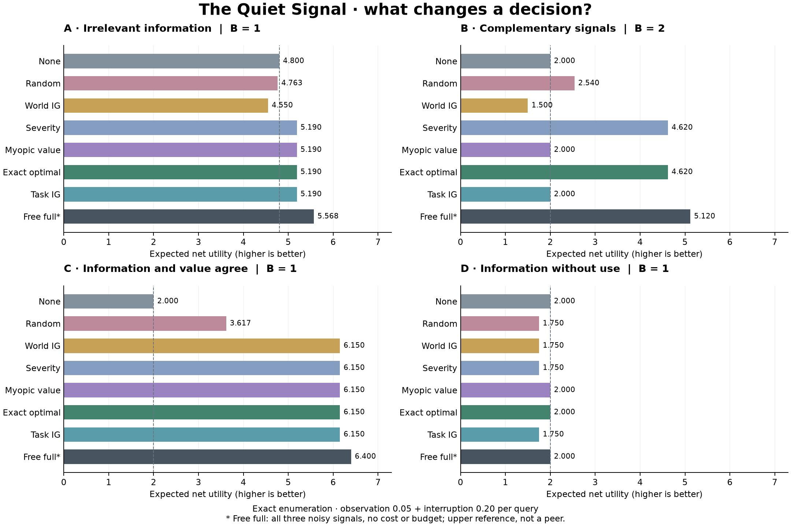

# The Quiet Signal

**A finite experiment in information, action, and silence**  
Commission: Ben Amuwo · November 8, 2026  
Implementation and analysis: Codex, with AI assistance disclosed below  
Status: tested local prototype; constructed examples, not publication-ready empirical research.

## Finding

Decision value can beat information gain when the information objective includes
irrelevant state. That advantage disappears in a matched example when information
is targeted at the decision. Greedy decision value also fails when two signals
are only useful together. A simple fixed priority rule can match the exact optimum.

These are existence demonstrations under known distributions, not estimates of
how often any strategy wins outside this deliberately small model.

## What was tested

One resource unit must be reserved (+2) or sent on one of two routes (+8 if correct,
−8 if wrong). Three imperfect binary monitors observe an eight-state world. A
query costs one packet slot and 0.05 observation utility plus an interruption
cost. The consumer chooses the Bayes-optimal action from the routed readings.
An exact adaptive solver can stop or select another monitor. The entire 64-atom
state/signal distribution is enumerated; there is no Monte Carlo error.

Seven budget-matched policies are compared: no monitoring, random, world
information gain, a fixed severity priority, myopic net decision value, exact
optimal allocation, and task information gain. An eighth reference receives all
three noisy signals free, outside the budget. It is not a peer.

## Exact results

Interruption cost = 0.20; total cost per queried sensor = 0.25.

| Policy | Distraction B=1 | Complementarity B=2 | Alignment B=1 | Disconnected B=1 |
| --- | ---: | ---: | ---: | ---: |
| No monitoring | 4.800 | 2.000 | 2.000 | 2.000 |
| Random | 4.763 | 2.540 | 3.617 | 1.750 |
| World information | 4.550 | 1.500 | 6.150 | 1.750 |
| Severity rule | 5.190 | 4.620 | 6.150 | 1.750 |
| Myopic value | 5.190 | 2.000 | 6.150 | 2.000 |
| Exact optimal | 5.190 | 4.620 | 6.150 | 2.000 |
| Task information | 5.190 | 2.000 | 6.150 | 1.750 |
| Free full signals* | 5.568 | 5.120 | 6.400 | 2.000 |

*Unconstrained, cost-free upper reference, using the same consumer gate.
All entries are expected net task utility; rounded only for display.

### The apparent win depends on the information target

In distraction, world-information selection buys a reliable observation of Y
while only X determines the correct route. Myopic and exact value selection earn
5.19 rather than 4.55. But task-information selection and the severity rule also
earn 5.19. This example does not demonstrate an advantage over either rival.
The highest information gain about the full state is answering the question it
was given; it is not a broken implementation.

### Silence can be shortsighted

In complementarity, X and Y are fair independent bits and the correct route is
X XOR Y. Each sensor alone leaves the route completely uncertain. Two sensors,
each 90% reliable, determine parity correctly with probability .9² + .1² = .82.
Their gross utility is 8(.82) − 8(.18) = 5.12; two queries cost .50, leaving 4.62.

Myopic value and task-information gain both stop at 2.00 because no single
query helps immediately. The fixed severity rule queries both and matches the
exact optimum. World information first spends a slot on irrelevant Z, yielding
1.50 at B=2. At B=3 it can finally access the pair. These are failures of the
specified greedy rules, not impossibility results for information or value methods.

### Being read is not being used

Alignment and disconnected share the same state and sensor distributions.
Disconnecting the consumer leaves the information unchanged. At B=1, querying
the best sensor reduces state uncertainty by about 0.531 bits in either world.
With the gate open, gross utility is 6.4. With it closed, gross utility remains
2, the action never changes, and querying reduces net utility to 1.75.

The control fixes state, noise, query transcript and cost, then replaces only
the consumer input. It does not infer use from a predictive correlation.
Individual message-removal effects are also reported, but need not identify all
joint contributions or redundant information.

### Costs and nonbinding capacity

At interruption cost 10, optimal and myopic select no queries in every base
fixture. In alignment at zero total cost and B=3, exact constrained value equals
the full-signal reference. The equality is tested across all base fixtures.
No full-information policy was slowed or artificially penalized to make a
compression story work. Compression itself was not tested.

## Sensitivity record

The base benchmark contains 640 rows: four worlds × five interruption costs ×
four budgets × eight policies. The additional grid contains 4,000 rows:
reliability {.5,.65,.8,.9,1} × complementarity {0,.25,.5,.75,1} × costs
{0,.2,1,3,10} × budgets {0,1,2,3} × eight policies. All three reliabilities are
set equal in that grid; the base cases have heterogeneous reliabilities.

Across the 500 equally counted grid configurations, myopic value wins/ties/loses
235/237/28 against world information, 157/329/14 against task information, and
310/162/28 against severity. These counts describe the chosen grid only; they
are not population frequencies, confidence estimates, or evidence that one
policy is generally superior. Every cell is retained in `results/sensitivity.csv`.

## Validation and boundaries

Hand-derived expected fixtures were written before the comparison run. A second
solver independently enumerates every adaptive policy tree using rational
arithmetic, checking three worlds × four budgets × three costs (36 cases).
The NumPy solver and its exact expectation evaluator agree with those values.
Tests cover normalization, Bayes conditioning, budget and cost accounting,
unused information, causal routing, expensive/uninformative silence, mixed target
outcomes, and deterministic replay. Browser expectation checks cover all 640
base rows, including exact averaging over random query orders; 35,840 deterministic
browser replay traces are checked against the exported engine results.

The browser consumes generated policy and posterior tables from the reference
engine. Its charts use exact averages; episodes use a seeded draw of a joint
state-and-noise atom. Alternate timelines preserve that atom. They are modeled
counterfactuals. The example JSON uses an explicitly selected fixed atom, not a
claim about a typical trajectory.

The final seven primary outputs repeat byte for byte in the isolated environment.
A comparison of system and isolated NumPy installations checked all 74,240 metric
cells; the largest absolute difference was 1.43×10⁻¹⁴ (rounded upward), below the
declared 10⁻¹⁰ tolerance. Different library builds can change final floating-point
digits and plot bytes despite matching version numbers. Cross-environment byte
identity is not promised. Both checks are recorded in `results/`.

The model assumes correct priors, correct noise models, finite known action
utilities, independent sensor noise conditional on state, and free computation.
Optimal's advantage over peers under those assumptions is guaranteed by its
optimization definition; that is an implementation check, not a discovery.
It knows no unqueried output and no true state. Severity's priority is fixed
in advance and may spend capacity unnecessarily. No learned monitoring or
real-world deployment has been evaluated. No human usability study or external
independent replication has been performed.

This is not a model of consciousness, human attention, clinical decisions, or
poverty. It does not establish strict metarepresentation or extend the claims
licensed by Sīdus. It does not reduce 無為 to an optimization problem.

## Inheritance and provenance

Local E0-A protocol and archived controls distinguish hiddenness, information,
and causal use; the informative-unused control is explicitly present. E0-B
materials address metarepresentational discrimination and consumer dependence;
we do not recast them as the result of this experiment. The November 4 E1 RC4
claim freeze reports a local PASS under its synthetic fixture. The commission's
reference to a developing E1 agenda therefore does not describe the entire
current local record. No canonical experiment was rerun or amended.

Piko's existing sprite sheet, manifest and Record are copied byte for byte.
The sheet matches its recorded SHA-256. Its original licence permits pet use,
including at work, and prohibits commercial replication/resale. No new character,
pet installation, Hatchery release or commercial rights claim was made.

The source ledger records inspected local file identities; it does not establish
an external chain of custody. AI assistance produced the formal toy model,
software, tests, analysis and interface. Ben Amuwo supplied the commission and
the prior creative/research materials. This is not an independent human review.

## Warranted next experiments

1. Perturb priors and sensor reliabilities while freezing the allocator's model;
   compare degradation against simple fixed rules and information baselines.
2. Add two-step value selection and joint task-information selection. Test
   whether they recover complementary value at lower computational cost.
3. Add correlated/redundant noise and randomized sensor ordering to separate
   structural failures from the current tie-breaking and priority choices.
4. Measure solver computation separately before introducing an explicit compute
   budget. Do not silently price computation as communication.
5. Conduct a small consent-based comprehension test: can a new reader distinguish
   an informative signal, a changed action, and a beneficial outcome?

Speculative extensions: learned allocators, dynamic obligations, human studies,
and broader Sīdus integration. None is necessary for this prototype's claims.

## Presentation v0.2

The subsequent presentation update adds a portfolio-aligned visual system and ten
Hatchery companions, including Shai-Ochre and Buer. Original scientific engine,
benchmark outputs and primary figure are unchanged. Asset provenance and UI
checks are recorded separately in `PRESENTATION_V02.md`. The v0.3 identity and the
hosted release are recorded in `PRESENTATION_V03.md`; neither changes a result.
